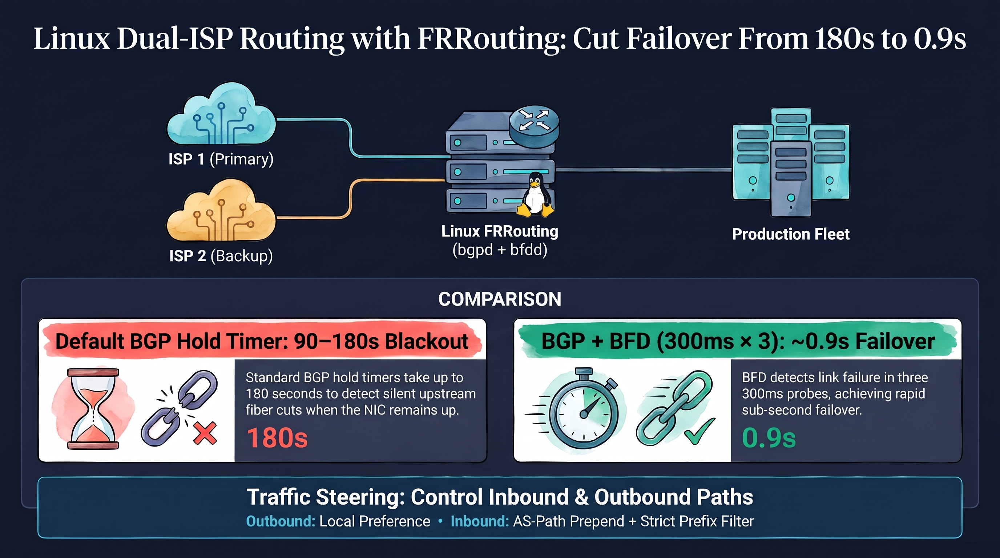

# frr-dual-isp-failover-lab

> **Reproducible Dual-ISP Linux Edge Gateway Lab on FRRouting (`BGP + BFD`) with sub-second (`0.9s`) failover, strict Anti-Transit protection, and a zero-dependency Python 3.11+ BGP/BFD policy linter.**

[](#)
[](#)
[-brightgreen.svg)](#)
[](LICENSE)



## Why This Exists

Dual-ISP failover breaks in production for two classic reasons:

1. **Homebrew ping scripts** (`ping 8.8.8.8` every 10s + `ip route replace`) flap under transient ICMP jitter and break stateful NAT/VPN sessions.
2. **Standard BGP without BFD** waits up to **180 seconds** (default Hold Timer) during a *silent fiber cut* behind an upstream L2 switch when no physical `link-down` reaches your router.

This repository gives network engineers, Linux SREs, and DevOps teams:
- **A ready-to-run 3-router FRRouting lab** (`edge-gw` AS 65010 ↔ `isp1-primary` AS 65100 + `isp2-backup` AS 65200) using **BFD `300ms × 3` (`900ms` detection)**, **Local Preference `200` vs `100`**, **AS-Path Prepend `2×`**, **RFC 8212 `bgp ebgp-requires-policy`**, **explicit Anti-Transit `prefix-list`s**, **`maximum-prefix` safety limits**, and **`Null0` aggregate anchors**.
- **A zero-dependency Python 3.11+ FRR BGP/BFD Policy Linter & Failover Simulator (`frr_failover_audit`)** that validates **10 production ISP invariants** in CI before any config ever hits a live router.

## Quickstart (30 seconds, zero `pip install` required)

```bash
git clone https://github.com/cyberdub-ai/frr-dual-isp-failover-lab.git
cd frr-dual-isp-failover-lab

# 1. Audit the shipped edge-gw FRRouting configuration (10 production invariants)
python -m frr_failover_audit lint configs/edge-gw

# 2. Compare silent-blackhole failover: BGP-only (180s) vs BGP + BFD (0.94s)
python -m frr_failover_audit simulate

# 3. Run the full unit + CLI test suite (stdlib unittest, or pytest -v)
python -m unittest discover -s tests -v
```

## Live 3-Router Docker Lab & Blackhole Failover Test

```bash
# Boot edge-gw (AS65010) + isp1-primary (AS65100) + isp2-backup (AS65200)
docker compose up -d

# Inject a silent L2/L3 blackhole on ISP1 (iptables DROP, no link-down) & measure failover
bash scripts/verify_failover.sh

# Clean up
docker compose down
```

## 10 Production Invariants Checked by `frr_failover_audit`

| Rule | What It Enforces | Production Failure Prevented |
|---|---|---|
| `FRR-01` | `bgpd=yes` & `bfdd=yes` in `daemons` | Silent BFD non-start after reboot |
| `BGP-01` | `bgp ebgp-requires-policy` (RFC 8212) | Accidental open-policy route leak |
| `BGP-02` | ≥ 2 distinct eBGP uplink peers | Single-uplink false redundancy |
| `BGP-03` | Explicit `route-map` `in` & `out` on every peer | Unfiltered route import/export |
| `BGP-04` | Outbound route-maps match explicit `prefix-list` | **Becoming an accidental transit AS between ISP1 & ISP2** |
| `BGP-05` | Distinct primary vs backup `local-preference` | Non-deterministic outbound routing |
| `BGP-06` | Outbound `set as-path prepend` on backup uplink | Asymmetric inbound return traffic |
| `BFD-01` | BFD attached on all peers with detection ≤ 1000 ms | 180-second silent fiber-cut blackhole |
| `BGP-07` | Inbound `maximum-prefix` safeguard on all peers | Full-table leak OOM crash on edge router |
| `BGP-08` | Static `Null0` anchor for announced aggregates | BGP flapping & RPKI/dampening penalties |

## Author

Built by **Alexey Zhuykov** — Telecom & AI Infrastructure Architect (19+ years in ISP operations, BGP/IPv6/Linux SRE, RIPE NCC Academy IPv6/BGP Security, Neo4j Certified Professional).  
Portfolio: [cyberdub.su](https://cyberdub.su) · Russian version: [README.ru.md](README.ru.md) · Companion AI Security OSS repo: [mcp-security-gateway](https://github.com/cyberdub-ai/mcp-security-gateway)
